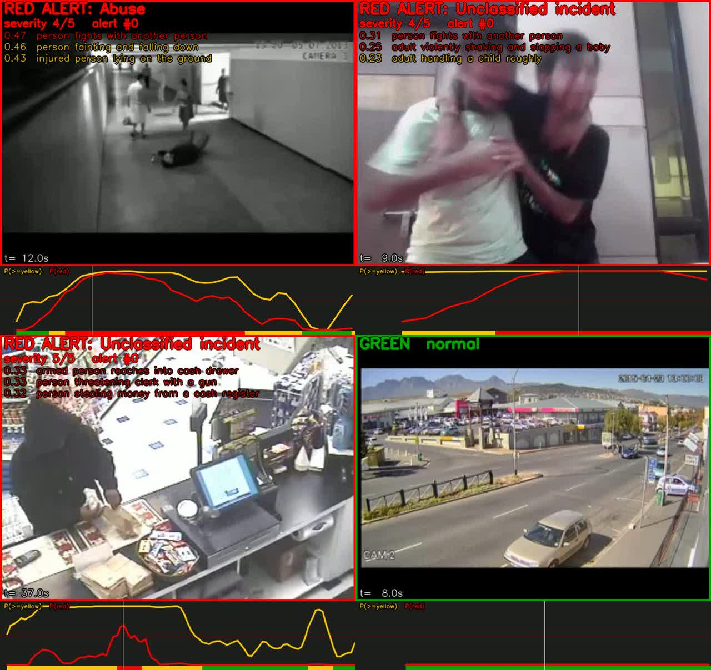
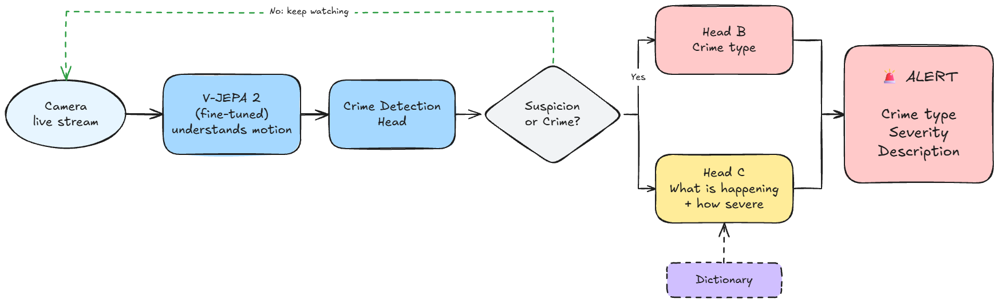

# REVERE — Boston Crime Intelligence Platform



REVERE is a real-time, AI-assisted crime-awareness platform for Boston. A
computer-vision detector flags incidents from CCTV/camera feeds and streams them
— with the video clip and metadata — to a FastAPI backend over WebSockets. The
backend powers two experiences:

- **Community portal** (public, no login) — residents explore crime rates across
  Boston neighborhoods (Roxbury, Dorchester, Mattapan, …) on a live map, with
  severity rankings, a crime-type breakdown, and a feed of *verified* incidents.
- **Officials portal** (login required) — a live command center showing every AI
  detection with its video clip and full metadata, plus **verify / dismiss**
  triage. Verified incidents are what the public sees.

## Architecture



```
 Detector (revere_websocket_new.py)     Backend (server.py)                Browsers
 ──────────────────────────────────     ───────────────────                ────────
 V-JEPA 2 + MIL heads, cuts a clip,     store clip + map to a Boston       Community  ◄─ ws /ws/dashboard?channel=public
 streams it  ─ws /ws/ingest─►           neighborhood, score severity,         (verified only, trimmed)
                                         broadcast per channel              Officials  ◄─ ws /ws/dashboard?channel=officials
                                                                               (full records + video)
```

## Tech stack

- **Backend:** FastAPI + Uvicorn, WebSockets, in-memory store
- **Frontend:** vanilla HTML/CSS/JS, [Leaflet](https://leafletjs.com) (keyless
  OpenStreetMap tiles), [Chart.js](https://www.chartjs.org)
- **Detector (current):** frozen **V-JEPA 2** ViT-L video encoder + lightweight
  MIL heads (`revere_websocket_new.py`) — see [`poc/training_phase1.md`](poc/training_phase1.md)
- **Detector (legacy):** TensorFlow/Keras CNN (`revere_detector.py`)

> **Model roadmap:** V-JEPA 2 is the detector we ship today. A purpose-trained
> final model is in progress and will replace it when ready — the backend/UI
> contract stays the same, so only the detector swaps out.

The platform also runs fine with **no detector at all** using simulated data via
`seed_demo.py`, which is the fastest way to see the dashboards.

---

## Quick start

### 1. Prerequisites
- Python 3.9+ (3.11 recommended)
- Git

### 2. Clone & enter
```bash
git clone https://github.com/omrastogi/revere.git
cd revere
```

### 3. Install dependencies

Just the web platform (no model):
```bash
pip install fastapi "uvicorn[standard]" websockets python-multipart
```

Everything including the detector:
```bash
pip install -r requirements.txt
```

### 4. Run the backend
```bash
python -m uvicorn server:app --host 0.0.0.0 --port 8000 --reload
```

> On Windows, if `python` isn't found, use `py` instead of `python`.

### 5. Open it
- Community portal: <http://127.0.0.1:8000/>
- Officials login:   <http://127.0.0.1:8000/login>

### 6. See it with data

Without a camera, populate demo detections across Boston neighborhoods:
```bash
python seed_demo.py 20
```
Refresh the community page — the map, rankings, and charts update live. Then log
in as an official and verify a few; verified incidents appear on the public feed.

---

## Officials login (demo credentials)

| Username | Password   |
|----------|------------|
| officer  | boston123  |
| admin    | vigilai    |

Defined in the `OFFICIALS` dict in `server.py`. **Replace these and use a real
user store with hashed passwords before any real deployment.**

---

## Running the detector — V-JEPA 2 (recommended)

`revere_websocket_new.py` is the current detector. It uses a **frozen V-JEPA 2
ViT-L** video encoder with two small MIL heads:

- **Head A** — anomaly detection: is this a crime, and in which segments?
- **Head B** — crime type, from the segments Head A flagged most strongly
  (classes: `Theft`, `Violence`, `FireExplosion`, `RoadAccidents`, `Vandalism`, `Arrest`).

On a detection it cuts a browser-playable `.webm` clip (the flagged span plus a
few seconds of padding, at the source frame rate) and streams it with metadata
to the backend. It opens a dark, REVERE-branded control panel with a live
activity log, a connection indicator, and an editable **backend address** field.

### Requirements

- **Python 3.11** recommended
- **`transformers >= 4.52`** and **`torch >= 2.1`** — V-JEPA 2 (`AutoVideoProcessor`)
  is not available in older versions. (An older environment will fail with
  `cannot import name 'AutoVideoProcessor'`.)
- The trained heads in `poc/ckpt/` (shipped in the repo).
- The V-JEPA 2 weights `facebook/vjepa2-vitl-fpc64-256` download automatically on
  first run via `transformers` (~GB). A GPU is much faster but CPU works.

```bash
pip install -r requirements.txt
```

### Run (detector on the same machine as the backend)
```bash
python revere_websocket_new.py
```

### Run (detector on another PC on the same Wi-Fi)
Point it at the backend machine's IPv4 — a bare IP is fine:
```bash
python revere_websocket_new.py --host 192.168.1.42
# or the full URL:
python revere_websocket_new.py --backend ws://192.168.1.42:8000/ws/ingest
```
You can also paste the IP into the **Server connection** field in the GUI and
click **Apply** / **Test**. Make sure the backend is started with
`--host 0.0.0.0` (it is, by default here) and that the server PC's firewall
allows inbound TCP 8000.

In the window, choose **Analyze Video File** or **Live Camera**. Press `q` in
the preview window to stop a live feed.

Environment overrides:

| Variable            | Default                         | Purpose                             |
|---------------------|---------------------------------|-------------------------------------|
| `REVERE_WS_BACKEND` | `ws://127.0.0.1:8000/ws/ingest` | Backend ingest WebSocket URL        |
| `REVERE_CLIP_DIR`   | `./clips`                       | Where clips are written             |
| `REVERE_POC_DIR`    | `./poc`                         | Folder holding `ckpt/` + helpers    |
| `REVERE_THRESHOLD`  | `0.5`                           | Head A anomaly-score threshold      |

### POC details

The training methodology, benchmarks (video ROC AUC **0.948** on UCF-Crime), and
the full pipeline live in [`poc/`](poc/) — see
[`poc/training_phase1.md`](poc/training_phase1.md). `poc/demo.py` can also run the
model on a video file and write an annotated output, independent of the backend.

---

## Running the legacy detector (TensorFlow CNN)

`revere_detector.py` is the earlier detector (Keras `model_8000.h5`). It's kept
for reference; prefer the V-JEPA 2 detector above.

1. Place `model_8000.h5` next to the script (or set `REVERE_MODEL_PATH`).
2. Start the backend, then: `python revere_detector.py`
3. Choose **Analyze Video File** or **Live Camera**; press `q` to stop.

Env overrides: `REVERE_MODEL_PATH`, `REVERE_CLIP_DIR`, `REVERE_WS_BACKEND`.

---

## HTTP & WebSocket API

| Route                              | Auth | Purpose                                  |
|------------------------------------|------|------------------------------------------|
| `GET /`                            | no   | Community portal                         |
| `GET /login`                       | no   | Officials login form                     |
| `POST /login`                      | no   | Authenticate, set session cookie         |
| `GET /logout`                      | —    | Clear session                            |
| `GET /officials`                   | yes  | Officials dashboard                      |
| `GET /api/stats`                   | no   | Neighborhood + crime aggregates          |
| `GET /api/detections`              | both | Public: verified+trimmed · Auth: full    |
| `POST /api/detections/{id}/status` | yes  | Set `verified` / `dismissed` / `pending` |
| `WS /ws/ingest`                    | —    | Detector pushes detections               |
| `WS /ws/dashboard?channel=…`       | —    | Live updates (`public` or `officials`)   |
| `GET /clips/<file>`                | no   | Saved video clips                        |

### Ingest message format

The detector sends one JSON text message per detection over `/ws/ingest`:

```json
{
  "crime":       "Violence",
  "location":    "Boston",
  "locality":    "Roxbury",
  "coordinates": "42.32,-71.09",
  "date":        "2026_10_24",
  "time":        "19_34_41",
  "confidence":  0.91,
  "filename":    "clip.webm",
  "video_b64":   "<base64 of the video file bytes>"
}
```
The server replies `{"ok": true, "id": "<detection id>"}`.
`confidence` (Head A's max segment score) is optional.

---

## Project layout

| File                      | Purpose                                           |
|---------------------------|---------------------------------------------------|
| `server.py`               | FastAPI app (auth, websockets, aggregation)       |
| `static/community.html`   | Public portal (Leaflet map + Chart.js)            |
| `static/login.html`       | Officials login                                   |
| `static/officials.html`   | Officials dashboard                               |
| `revere_websocket_new.py` | **Current detector** — V-JEPA 2 + MIL heads + GUI |
| `revere_detector.py`      | Legacy detector — TensorFlow CNN + GUI            |
| `revere_sender.py`        | Reusable detector helper (`send_detection`)       |
| `send_test.py`            | Single-detection test client                      |
| `seed_demo.py`            | Bulk demo-data seeder                             |
| `poc/`                    | V-JEPA 2 training pipeline + checkpoints          |
| `requirements.txt`        | Python dependencies                               |
| `asset/`                  | README images (teaser, flowchart)                 |
| `clips/`                  | Saved video clips (runtime; git-ignored)          |

---

## Notes & caveats

- **State is in memory.** Restarting the backend clears detections (clips on disk
  remain). Swap the `DETECTIONS` list for a database to persist.
- **Auth is demo-grade** (plain dict + in-memory sessions). Use real users,
  hashed passwords, and signed sessions for production.
- **Map tiles** use OpenStreetMap's public servers (keyless). For heavy traffic,
  use a paid tile provider or your own tile cache per the OSM fair-use policy.
- **Large clips** are base64'd into one WebSocket message. For production, prefer
  a chunked or HTTP multipart upload for video.
- REVERE reflects AI detections reviewed by officials and is **not** a substitute
  for official police statistics.
